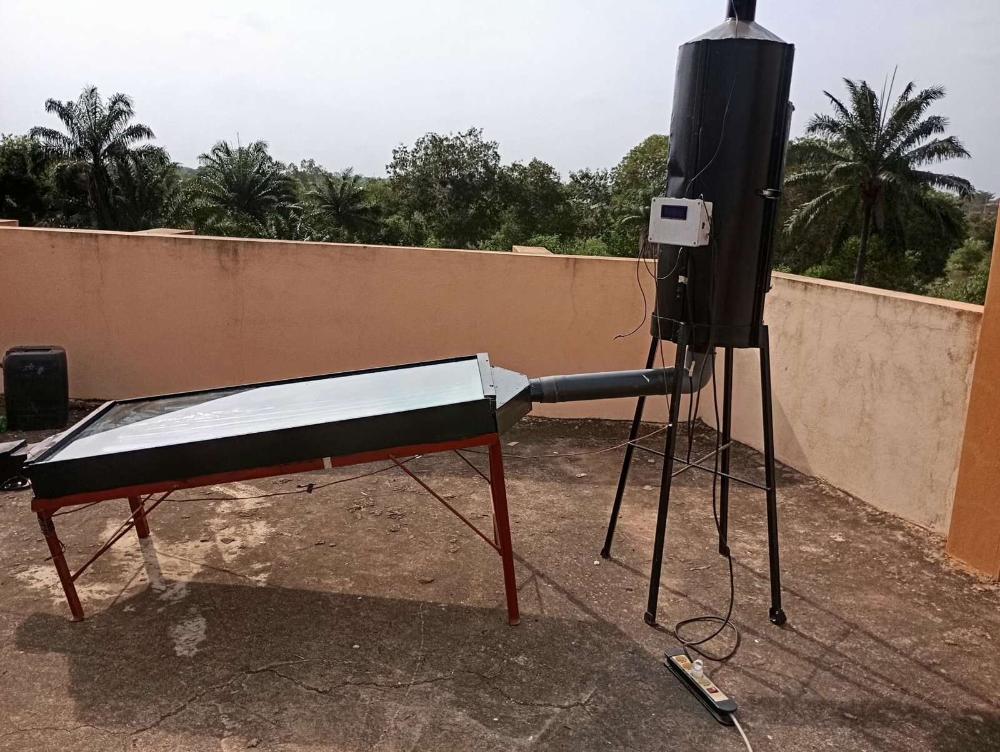
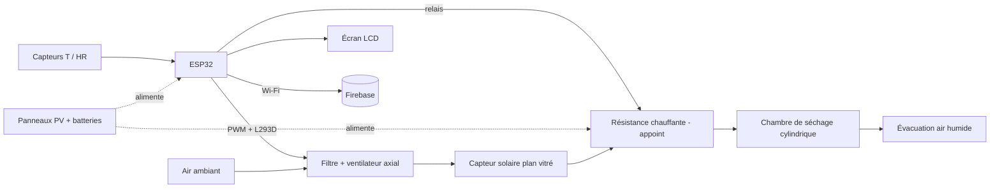
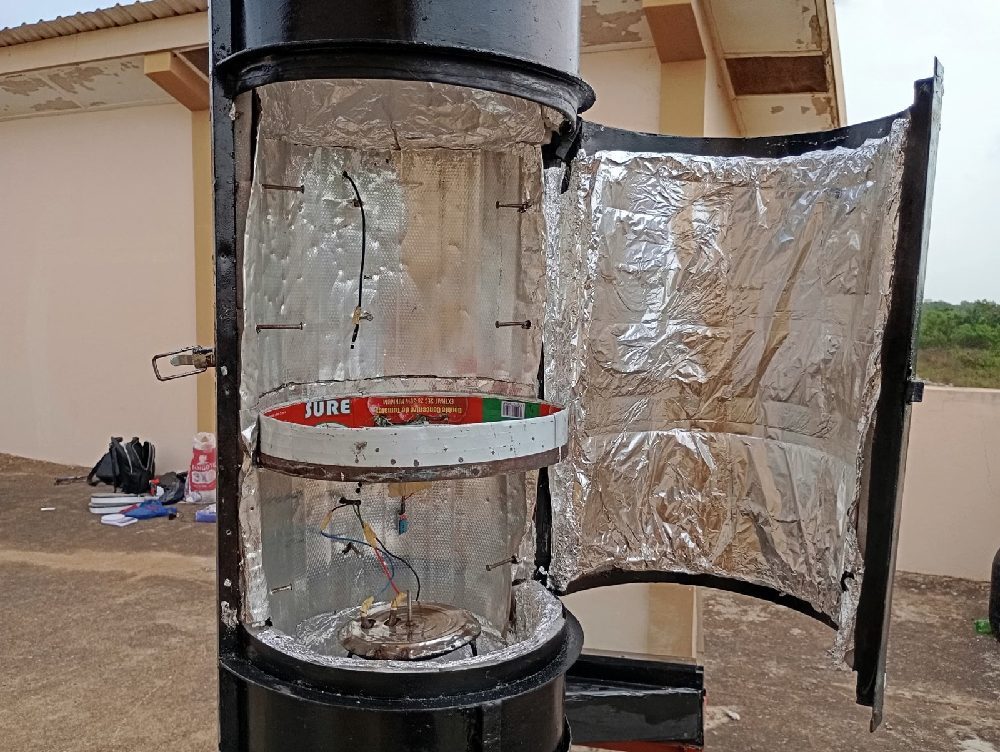
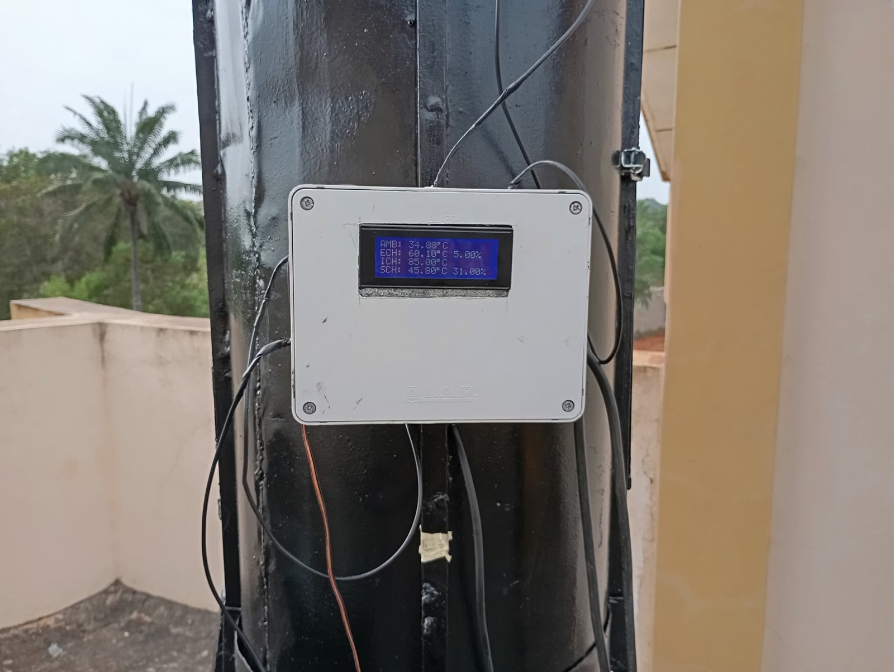

# sechoir-aklui
# ☀️ Séchoir hybride intelligent pour granulés de maïs « Aklui »

Conception et réalisation d'un **séchoir indirect hybride (solaire thermique + électrique) à fonctionnement automatique**, destiné au séchage des granulés de maïs *Aklui* en Afrique de l'Ouest (cas du Bénin).

*Vue d'ensemble du prototype : capteur solaire plan vitré (à gauche) relié à la chambre de séchage cylindrique (à droite).*

---

## 🎯 Contexte et objectif

L'Aklui est un produit post-récolte très apprécié au Bénin, mais difficile à conserver : mal séché, il s'échauffe et perd son acidité. Le séchage au soleil en plein air est lent et dépend de la météo.

**Objectif** : concevoir un séchoir capable de sécher efficacement et rapidement l'Aklui, avec une régulation automatique de la température, quelles que soient les conditions d'ensoleillement.

| Élément | Valeur |
|---|---|
| Produit | Granulés de maïs « Aklui » |
| Quantité à sécher (prototype) | 2 kg |
| Lieu d'essai | Abomey-Calavi (Bénin) |
| Température de séchage | 60 °C (phases I et II), 55 °C (phase III) |

> Le brunissement des granulés apparaît au-delà de 60 °C : le séchage indirect a été retenu pour mieux contrôler les conditions de séchage et préserver la qualité du produit.

---

## ⚙️ Principe de fonctionnement

1. Un **ventilateur axial** aspire l'air ambiant, qui traverse un filtre.
2. L'air est préchauffé dans un **capteur solaire plan vitré**.
3. Si l'ensoleillement est insuffisant, une **résistance chauffante** complète le chauffage (alimentée par batterie solaire ou par le réseau SBEE).
4. L'air chaud et sec traverse la **chambre de séchage cylindrique** et absorbe l'humidité des granulés.
5. L'air chargé d'humidité est évacué par la partie inférieure du séchoir.
6. Un **ESP32** mesure les températures et humidités, régule la résistance et le ventilateur, affiche les valeurs sur un LCD et les envoie vers le cloud.

*Intérieur de la chambre de séchage : isolation en aluminium, claie pour les granulés, sondes de température et résistance chauffante en partie basse.*

---

## 📐 Dimensionnement (résultats principaux)

| Paramètre | Valeur |
|---|---|
| Quantité d'eau à extraire (pour 2 kg frais) | 0,77 kg |
| Vitesse d'enlèvement de l'eau | 0,13 kg/h |
| Débit d'air nécessaire | 9,47 m³/h |
| Puissance thermique nécessaire | 0,14 kW |
| Pertes thermiques de la chambre | 0,013 kW |
| Énergie nécessaire au séchage | 0,92 kWh |
| Capteur solaire | 1 m² (1,50 m × 0,70 m) |
| Résistance chauffante | 500 W (dimensionnée pour l'irradiation la plus défavorable) |
| Ventilateurs | 2 × 25 W (DC) |

Le débit du ventilateur est choisi égal à deux fois le débit d'air calculé.

### Alimentation photovoltaïque

| Composant | Choix |
|---|---|
| Panneaux | 2 × 450 Wc (monocristallin bifacial, JA Solar) |
| Tension du système | 24 V |
| Batteries | AGM Victron 12 V / 38 Ah |
| Régulateur de charge | Victron BlueSolar 100 V / 20 A |
| Onduleur | Victron Phoenix 24 V / 800 VA |

Utilisation prévue : 8 h par jour, pas de fonctionnement la nuit.

---

## 🧠 Système de régulation

Le bloc de régulation maintient la température de séchage en pilotant la résistance chauffante et le ventilateur.

**Capteurs (4 températures, 2 humidités)** : entrée du capteur solaire, sortie du capteur solaire, intérieur de la chambre, sortie de la chambre ; humidité en sortie du capteur et en sortie de la chambre.

**Algorithme prévu (conception)** :

| Situation | Résistance | Ventilateur |
|---|---|---|
| Température > consigne | Arrêtée | Vitesse augmentée (PWM issu du PID) |
| Température < consigne | Allumée | Vitesse réduite (PWM issu du PID) |
| Phase III | Consigne abaissée à 55 °C | — |
| Fin de séchage | Arrêt du séchage | — |

*Boîtier de régulation (ESP32) avec l'afficheur LCD 20×4 : températures AMB, ECH, ICH, SCH et humidités.*

👉 Le détail du programme et ses écarts avec cette conception sont dans [`firmware/README.md`](firmware/README.md).

---

## 🧰 Matériel électronique

| Composant | Rôle |
|---|---|
| ESP32 DevKit | Microcontrôleur, Wi-Fi |
| 2 × DHT11 | Température et humidité |
| 2 × DS18B20 | Température |
| Module relais | Commande de la résistance chauffante |
| Driver L293D | Commande PWM du ventilateur |
| LCD 20×4 I2C | Affichage local |

---

## 💰 Coût du prototype

| Poste | Coût (FCFA) |
|---|---|
| Bloc de séchage | 68 600 |
| Bloc de régulation | 25 300 |
| Bloc d'alimentation (PV) | 525 000 |
| Main d'œuvre | 60 000 |
| **Total** | **762 900** |

Le système photovoltaïque représente à lui seul environ 80 % du budget.

---

## 🔭 Perspectives

- Mise en œuvre complète de l'algorithme de régulation décrit dans le mémoire (phases, fin de séchage).
- Régulation sur l'humidité de l'air sortant, pas seulement sur la température.
- Application mobile et tableau de bord web pour le suivi à distance.
- Réduction du coût du système photovoltaïque pour un déploiement à plus grande échelle.

---

## 👤 Auteur et encadrement

**Othniel AHUI** — Ingénieur en génie énergétique et procédés (ENSGEP – UNSTIM).

- Supervision : Dr Christian Djidjoho AKOWANOU (UNSTIM)
- Encadrement : Dr Mounirou KARIMOU (ENSGEP/UNSTIM)
- Tuteur de stage : M. Cyriano KOULETIO (ARESS)
